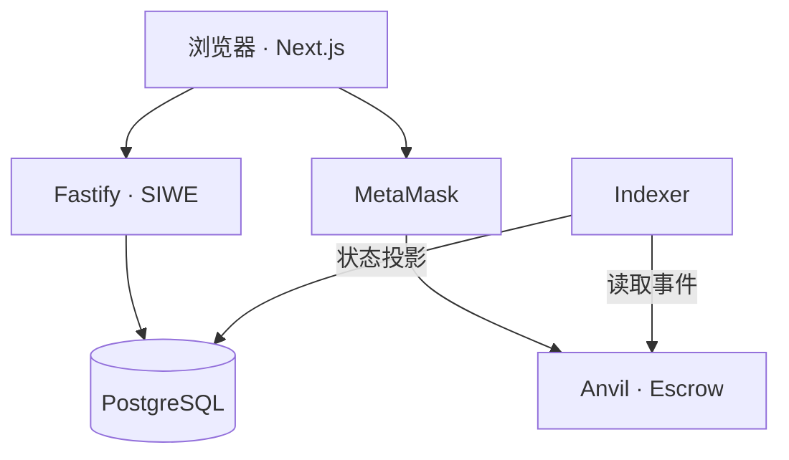

# Milestone Escrow

基于本地Anvil链的Web3里程碑托管付款项目，用于学习和展示完整全栈业务流程。

## 项目范围

学习版V1以本地可运行、可复现、测试和文档完整为完成标准。

测试网和公网部署作为可选扩展。

## 技术栈

- 前端：Next.js、React、TypeScript、wagmi、viem
- 后端：Node.js、Fastify、SIWE
- 数据库：PostgreSQL、pg
- 链上：Solidity、Foundry、Anvil、Mock USDC
- 同步与验证：Indexer、Docker Compose、Playwright、GitHub Actions

## 架构



API保存项目、验证身份并处理成果提交。
钱包签署消息和发送交易。
Indexer从持久化游标读取事件，校验链上与数据库参数后更新状态。

## 业务流程

Alice登录 → 创建链下项目 → 链上注册 → Approve/Fund →
Bob提交成果 → Alice释放 → Indexer更新PAID →
全部付款后COMPLETED。

项目状态：

AWAITING_FUNDING → ACTIVE → COMPLETED

里程碑状态：

PENDING → SUBMITTED → PAID

金额使用六位小数Mock USDC。
数据库/API保存最小单位整数字符串，计算使用bigint。

## 本地环境

复现时使用与CI一致的工具版本：
Node 22、pnpm 12.11.2、Foundry，以及Docker Compose。

| 服务 | 地址 |
|---|---|
| Web | http://localhost:3000 |
| API | http://localhost:3001 |
| Anvil RPC | http://127.0.0.1:8545 |
| chainId | 31337 |
| 宿主机PostgreSQL | 127.0.0.1:5433 |
| 容器内PostgreSQL | postgres:5432 |

## 从空环境启动

本节用于全新机器或隔离环境。
已有环境复用原Anvil、合约地址和数据库。

```bash
git clone --recurse-submodules YOUR_REPOSITORY_URL milestone-escrow
cd milestone-escrow

pnpm install --frozen-lockfile
```

终端一启动全新的本地链：

```bash
anvil --host 0.0.0.0 --port 8545 --chain-id 31337
```

终端二进入packages/contracts，
复制.env.example为.env。

RPC_URL填写http://127.0.0.1:8545。
ANVIL_PRIVATE_KEY填写Anvil输出的账户0测试私钥。

```bash
cd packages/contracts

forge script script/DeployLocal.s.sol:DeployLocal --rpc-url local --broadcast -vv
```

记录实际Mock USDC地址、Escrow地址及Escrow创建区块。

回到仓库根目录，复制模板：

```bash
cp services/api/.env.docker.example services/api/.env.docker
cp services/indexer/.env.docker.example services/indexer/.env.docker
cp apps/web/.env.docker.example apps/web/.env.docker
cp tests/integration/.env.example tests/integration/.env
```

填写实际合约地址、部署区块，以及集成测试使用的Anvil账户0/1测试私钥。

启动：

```bash
docker compose -f infra/docker/compose.yaml config --quiet

docker compose -f infra/docker/compose.yaml up -d postgres

docker compose -f infra/docker/compose.yaml run --rm migrate

docker compose -f infra/docker/compose.yaml up -d --build api indexer web
```

访问http://localhost:3000。

MetaMask连接Anvil网络，使用测试账户作为Alice和Bob。

## 自动化验证

在仓库根目录执行：

```bash
pnpm check

pnpm test:integration
```

check执行类型检查与合约测试。

集成测试需要运行中的Anvil、数据库、API和Indexer，
使用新项目验证正常闭环及不匹配事件处理。

GitHub Actions在新Runner中执行：

- 类型检查
- Solidity格式、构建与测试
- Docker镜像构建
- Web首页HTTP检查
- API、链、Indexer集成测试

钱包浏览器交互通过本机演示验收。

实际结果记录在docs/ACCEPTANCE.md。

## 当前边界

- 使用本地链和测试代币。
- 成果提交及按序提交由API控制。
- 合约负责客户权限和资金托管、释放。
- 交易恢复尚未覆盖全部交易替换和无哈希情形。
- Indexer拒绝错误业务映射，合约层尚未预防projectId抢占。
- 本地使用latest同步，尚未实现重组后的数据库投影回滚。
- 退款、争议仲裁和公网部署属于后续扩展。
- 未持久化的Anvil重启会产生新链，不能与旧数据库投影混用。